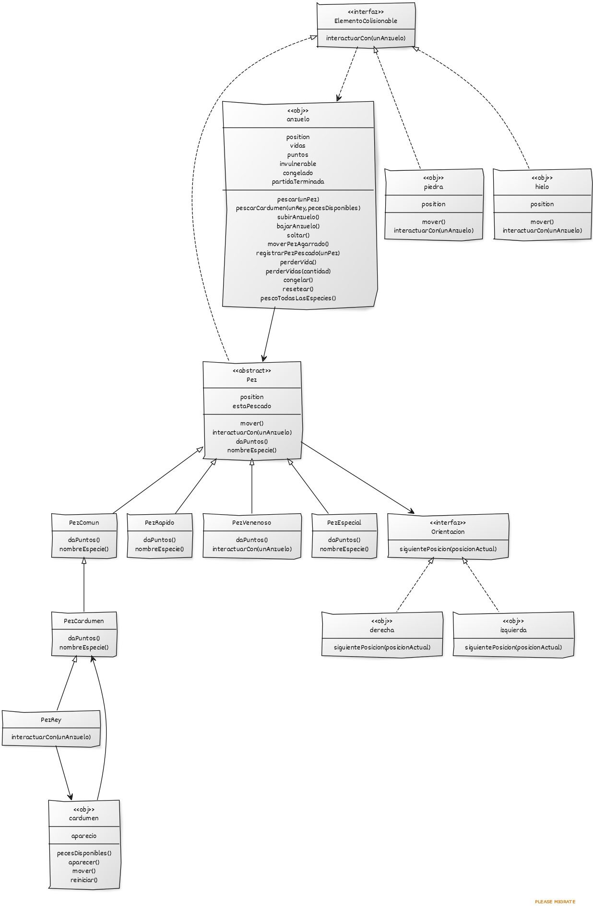

# Explicaciones teóricas

## polimorfismo

se aplica en las colisiones , cuando el anzuelo colisiona con un elemento, cada uno maneja la interaccion a su manera mediante interactuarCon(unAnzuelo):
- los peces se pescan
- la piedra suelta el pez y resta 2 vidas
- el hielo congela el anzuelo
- el pez venenoso resta una vida

## herencia

existe una jerarquia de clases: "pez" es la clase padre de la cual heredan "pezComun", "pezRapido" y "pezVenenoso". A su vez "pezComun" es padre de "pezCardumen", que es padre de "pezRey"

## colecciones

se usan listas para manejar los peces en agua, los peces pescados y el cardumen. 

# Diagramas

