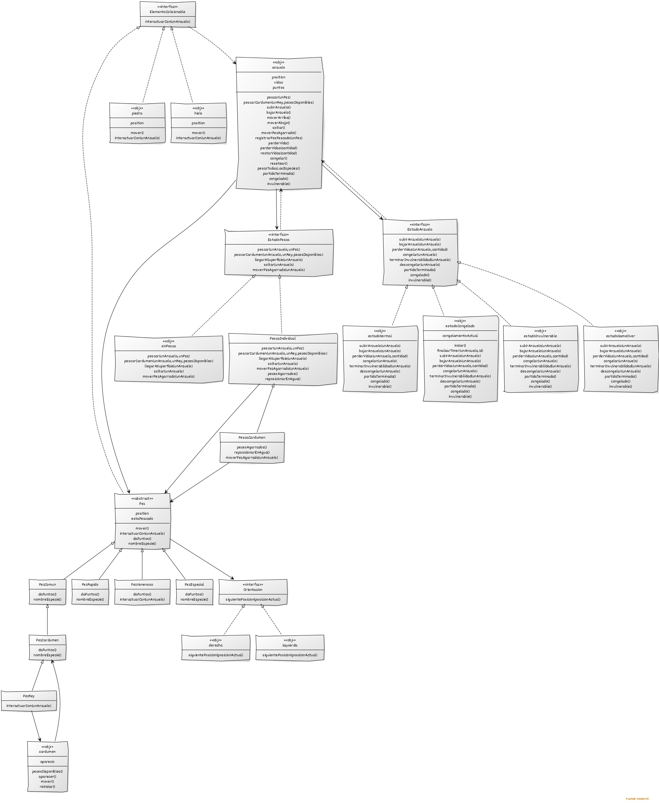

# Explicaciones teóricas

## polimorfismo

El polimorfismo permite que distintos objetos respondan a un mismo mensaje basandose en su propia logica, algo que permite evitar condicionales que pregunten por el tipo o el estado de un objeto. Algunos casos donde lo usamos fueron:

- Colisiones con el anzuelo: al detectarse una colision con anzuelo, se ejecuta directamente elemento.interactuarCon(anzuelo). Cada elemento resuelve su propio comportamiento: los peces comunes se enganchan con pescar, el PezRey captura al cardumen disponible, el PezVenenoso resta una vida, la piedra suelta la pesca y resta dos vidas, y el hielo congela al anzuelo.

- Orientacion de los peces: los objetos derecha e izquierda entienden los métodos imagen() y siguientePosicion(posicionActual), lo que permite que cualquier pez calcule como orientarse

- Estados de captura y del jugador: tanto los estados de pesca (sinPesca, PescaIndividual, PescaCardumen) como los estados del anzuelo (estadoNormal, estadoCongelado, estadoInvulnerable, estadoGameOver) comparten una misma interfaz. El anzuelo delega en ellos acciones como subir, bajar, pescar, soltar, recibir daño o finalizar un temporizador (terminarInvulnerabilidad, descongelar), sin necesidad de if dentro del anzuelo que consulte en que estado se encuentran

## herencia

Aplicamos herencia para poder compartir atributos y comportamiento comun entre abstracciones relacionadas, de forma que nos permite evitar repetir codigo y redefinir unicamente lo especifico de cada subclase:

- Jerarquia de peces: La clase Pez centraliza los atributos (position, orientacion, estaPescado) y el comportamiento base (mover(), image(), interactuarCon()). De ella heredan PezComun, PezRapido, PezVenenoso y PezEspecial redefiniendo cada una su puntaje (daPuntos()) y aspecto, o su interaccion como en el caso del venenoso. Ademas, PezCardumen hereda de PezComun reutilizando su movimiento y cambiando puntaje/imagen, y es superclase de PezRey, que redefine interactuarCon(unAnzuelo) para capturar tambien a sus acompañantes

- Estados de captura: PescaCardumen hereda de PescaIndividual, de forma que reutiliza la referencia al pez principal (pezAgarrado) y hereda sin cambios llegarASuperficie(unAnzuelo) y soltar(unAnzuelo), que trabajan de forma polimorfica sobre pecesAgarrados(). Asi, PescaCardumen solo redefine pecesAgarrados() (sumando los acompañantes), reposicionarEnAgua() (ubicando a los tres peces en distintas columnas o delegando en super() si no hay acompañantes) y moverPezAgarrado(unAnzuelo) (usando super(unAnzuelo) en el caso normal y fijando al rey cuando está cerca del fondo para alinear debajo a sus acompañantes)

## composicion

Para evitar que anzuelo concentre demasiados condicionales se delega su comportamiento cambiante mediante composicion usando dos ayudantes internos:

- estadoPesca: modela la situacion actual de captura con sinPesca, PescaIndividual o PescaCardumen.

- estado: modela si el jugador puede moverse, si está congelado, si es invulnerable o si perdió la partida (estadoNormal, estadoCongelado, estadoInvulnerable y estadoGameOver).

- Composicion vs herencia: a diferencia de las especies de peces (cuyo tipo es fijo desde que se instancian), la condicion del anzuelo cambia dinamicamente en tiempo de ejecucion durante una misma partida (pasa de libre a pescar un cardumen, o de normal a congelado e invulnerable). La composicion permite ir cambiando estos objetos constantemente (unAnzuelo.estado(...) y unAnzuelo.estadoPesca(...)), dejando que cada estado decida a cual pasar despues y facilitando agregar nuevos estados sin modificar el anzuelo ni el resto del juego.

## colecciones

Se usan colecciones para manejar grupos de objetos dinamicos durante la partida y consultar su informacion sin recorrer indices manualmente:

- En juego.wpgm, colecciones como pecesComunes, pecesRapidos y pecesEspeciales permiten mover los peces activos en cada tick y limpiar el tablero al reiniciar la partida.

- En cardumen, la lista integrantes agrupa a los tres peces del cardumen para filtrar cuales siguen disponibles (pecesDisponibles()) o verificar si alguno ya fue pescado.

- En anzuelo, la lista pecesPescados almacena las capturas confirmadas para luego poder calcular estadisticas por especie en la pantalla de Game Over y habilitar ademas la aparicion del PezEspecial.

## bloques

Los bloques se utilizan tanto para programar acciones que ocurren con el tiempo o ante eventos del juego, como tambien para trabajar con colecciones:

- Eventos y temporizadores: en juego.wpgm se pasan bloques a game.onTick (para ciclos de movimiento y reloj de partida), onPressDo en las teclas de control y reinicio (keyboard.up(), keyboard.down(), keyboard.space() y keyboard.r()) y game.whenCollideDo (para detectar colisiones). En anzuelo.wlk, estadoNormal utiliza game.schedule con bloques para desactivar la invulnerabilidad al segundo y finalizar el congelamiento a los dos segundos.

- Se emplean bloques junto con forEach, filter y count (por ejemplo en cardumen con filter, sinPesca con filter y forEach, PescaIndividual con forEach y anzuelo con count) para filtrar acompañantes, registrar capturas o contar peces por especie de forma clara y concisa.

# Diagramas

